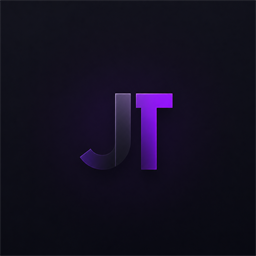

<p align="center">
  
</p>

# JTech Browser

A privacy-focused desktop web browser for Windows, built with **Tauri 2**, **Rust**, **WebView2**
and a **React/TypeScript** UI, with network-level ad and tracker blocking powered by Brave's
[adblock-rust](https://github.com/brave/adblock-rust).

> Status: early development (0.x). Windows only.

## Features

- Vertical tab sidebar with pinning, drag & drop, tab groups, tab sleep for inactive tabs,
  session restore and per-site zoom.
- Ad and tracker blocker (EasyList, EasyPrivacy, optional uBlock, Peter Lowe and Fanboy lists)
  with automatic filter list updates, a per-site allowlist and basic cosmetic filtering.
- Privacy dashboard: block statistics, cookies per site, clear browsing data, clear cookies and
  cache on exit.
- Site permissions (camera, microphone, location, notifications) with a prompt bar and
  per-site memory.
- Bookmarks, bookmarks bar, history, downloads, find in page, print and a command palette.
- Fully customizable keyboard shortcuts.
- Design studio: themes, presets, animated backgrounds, custom cursors and cursor trails.
- Audio hub: see and mute tabs that are playing audio.
- All data is stored locally in SQLite (`%APPDATA%\com.jtech.browser\jtech.sqlite3`).
- Signed automatic updates from GitHub Releases.

## Ad blocking: coverage and limits

Requests are filtered in Rust on WebView2's `WebResourceRequested` event. The blocker is useful
but does not reach parity with browser extensions such as uBlock Origin. Known limits:

- Requests from **service workers** may not be reported, depending on the WebView2 runtime.
- **WebSocket messages** after the handshake cannot be filtered; some cross-origin iframes and
  popups may be covered only partially.
- The main document itself is never blocked (by design).
- `$redirect` / replacement resources, `$csp`, `$removeparam` and `$header` rules are not
  applied; blocked requests receive an empty `204` response.
- Cosmetic filters are applied once at `DOMContentLoaded`, in the main frame only; elements added
  later are not re-checked, so a brief flash is possible.
- **Procedural cosmetic filters** (`:has-text`, `:upward`, …) and **scriptlets** (`+js(...)`)
  are not executed, so parts of the uBlock and annoyance lists have no effect.
- The displayed rule count is an approximation.

Details: [docs/ADBLOCK.md](docs/ADBLOCK.md).

## Tech stack

| Layer | Technology |
|---|---|
| Shell | Tauri 2 (multi-webview, `unstable` feature) |
| Engine | Microsoft Edge WebView2 (via `webview2-com`) |
| Backend | Rust 2024 edition, `adblock` 0.13, `rusqlite` (bundled SQLite), `reqwest` |
| UI | React 19, TypeScript, Vite |
| Updates | `tauri-plugin-updater` + `tauri-plugin-process`, GitHub Actions + `tauri-action` |

## Building from source

Requirements: Windows 10/11, [Node.js](https://nodejs.org/) 20+,
[Rust](https://rustup.rs/) (stable, MSVC toolchain), Visual Studio Build Tools
("Desktop development with C++") and the WebView2 runtime (preinstalled on Windows 11).

```
npm install
npm run tauri dev      # development build with hot reload
npm run tauri build    # release build with NSIS/MSI installers in src-tauri/target/release/bundle
```

Release builds also produce signed updater artifacts. For a local build without the project's
signing key, set `bundle.createUpdaterArtifacts` to `false` in `src-tauri/tauri.conf.json`.

Rust tests: `cd src-tauri && cargo test`. Type check of the UI: `npx tsc --noEmit`.

## Automatic updates

Installed copies periodically check the latest GitHub Release for a signed update (this can be
turned off in Settings), verify its signature and offer to install it.

## Project layout

```
src/                     React UI (pages, components, store, lib)
src-tauri/src/           Rust backend (tabs/webviews, filters, privacy, storage, UI effects)
src-tauri/capabilities/  Tauri permissions (browser UI only)
.github/workflows/       Release pipeline
docs/                    Architecture and ad blocking documentation
```

- [docs/ARCHITECTURE.md](docs/ARCHITECTURE.md): windows, webviews, tabs, internal pages, IPC and storage
- [docs/ADBLOCK.md](docs/ADBLOCK.md): filter engine, filter lists, coverage and limitations

## License

See [LICENSE](LICENSE).
